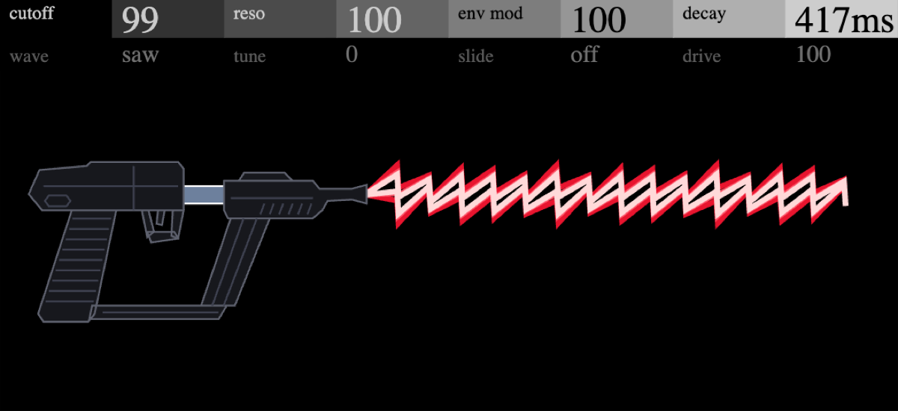

# Acidgun



**[Pruébalo en el navegador](https://jjaimeros.github.io/op-xy-color-synths-things/acidgun/docs/)**: con sonido y sin instalar nada.

Bajo ácido al estilo TB-303 para el OP-XY, como motor de [Open-XY](https://github.com/etcetc000/open-xy) (ID `acidgun`).

| Página | Pote 1 | Pote 2 | Pote 3 | Pote 4 |
|---|---|---|---|---|
| 1 | Cutoff (100..1500 Hz) | Reso | Env Mod | Decay |
| 2 | Wave (saw/sqr) | Tune (±12 st) | Slide (0..600 ms) | Drive |

Pulsar un encoder cambia de página. Es monofónico como la 303, con deslizamiento entre notas. No tiene accent, porque el SDK no da la velocidad al motor.

El firmware instala un solo preset, `presets/default.json`. En la web suena con los mismos 8 parámetros.

En pantalla, una pistola de rayos dispara un láser rojo (saw) o azul (sqr), con chispas según Env Mod.

## Desarrollo

Se compila con el [SDK de Open-XY](https://github.com/etcetc000/open-xy), con el SDK en una carpeta al lado de este repositorio y con el [parche del SDK](../sdk-patch) aplicado:

```sh
python sdk.py test --machine ../op-xy-color-synths-things/acidgun --firmware
python sdk.py preview --source ../op-xy-color-synths-things/acidgun --out local/acidgun-prev --overwrite
```

No usa aritmética de 64 bits ni coma flotante en el motor (el compilador Blackfin para Mac no trae `libgcc`).

Firmware no oficial: úsalo bajo tu responsabilidad. Sin relación con Teenage Engineering.

`tables.py` genera `tables.h`. `artwork.py` genera la pantalla a partir de `pistola.svg` (python3.12).

## Créditos y licencia

- Filtro y envolvente basados en [Open303](https://github.com/RobinSchmidt/Open303), de Robin Schmidt (MIT).
- El código es MIT, ver [LICENSE](LICENSE). La web de `docs/` usa la vista previa de Open-XY (MIT, ver `docs/LICENSE-Open-XY`).
- **El dibujo de la pistola (`pistola.svg`, `pantalla.png` y su parte en `panel.svg.fragment` y `docs/preview/panel.svg`) queda fuera de la licencia MIT.** Es un homenaje rediseñado a partir de una pistola de ciencia ficción de los 80, sin afiliación con sus dueños, cuyos derechos les corresponden.

Más sintes para el OP-XY en [op-xy-color-synths-things](..).
