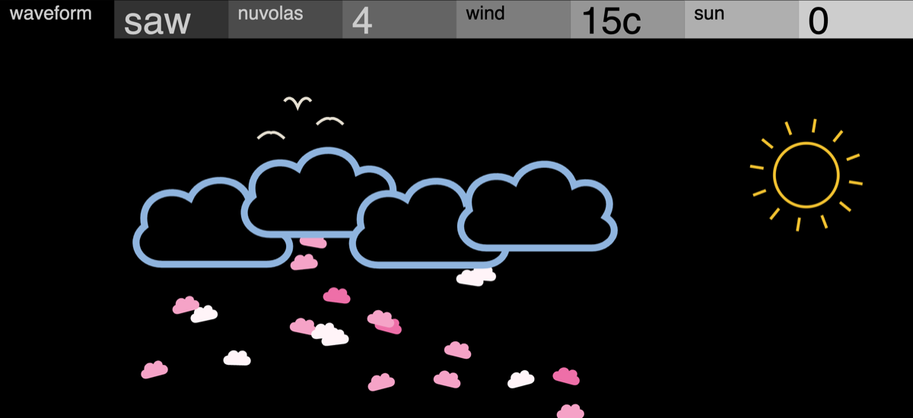

# Nuvola



**[Pruébalo en el navegador](https://jjaimeros.github.io/op-xy-color-synths-things/nuvola/docs/)**: con sonido y sin instalar nada.

Sinte de nubes para el OP-XY, como motor de [Open-XY](https://github.com/etcetc000/open-xy) (ID `nuvola`).

| Pote | Control | Qué hace |
|---|---|---|
| 1 | Waveform | saw, sqr, pulse, sine, saw+sqr |
| 2 | Nuvolas | 1..5 osciladores al unísono, una nube por oscilador |
| 3 | Wind | detune de 0 a 50 cents: las nubes se separan y llegan rachas de viento |
| 4 | Sun | deriva por nube hasta ±15 cents: el sol crece |

Al tocar caen nubecitas de golosina y los pájaros vuelan siempre. El volumen se mantiene constante con el detune: se compensa por armónicos a partir de las fases, con un limitador suave.

## Desarrollo

Se compila con el [SDK de Open-XY](https://github.com/etcetc000/open-xy), con el SDK en una carpeta al lado de este repositorio y con el [parche del SDK](../sdk-patch) aplicado:

```sh
python sdk.py test --machine ../op-xy-color-synths-things/nuvola --firmware
python sdk.py preview --source ../op-xy-color-synths-things/nuvola --out local/nuvola-prev --overwrite
```

No usa aritmética de 64 bits ni coma flotante en el motor (el compilador Blackfin para Mac no trae `libgcc`).

Firmware no oficial: úsalo bajo tu responsabilidad. Sin relación con Teenage Engineering.

`artwork.py` genera la pantalla (python3.12).

## Licencia

MIT, ver [LICENSE](LICENSE). La web de `docs/` usa la vista previa de Open-XY (MIT, ver `docs/LICENSE-Open-XY`).

Más sintes para el OP-XY en [op-xy-color-synths-things](..).
