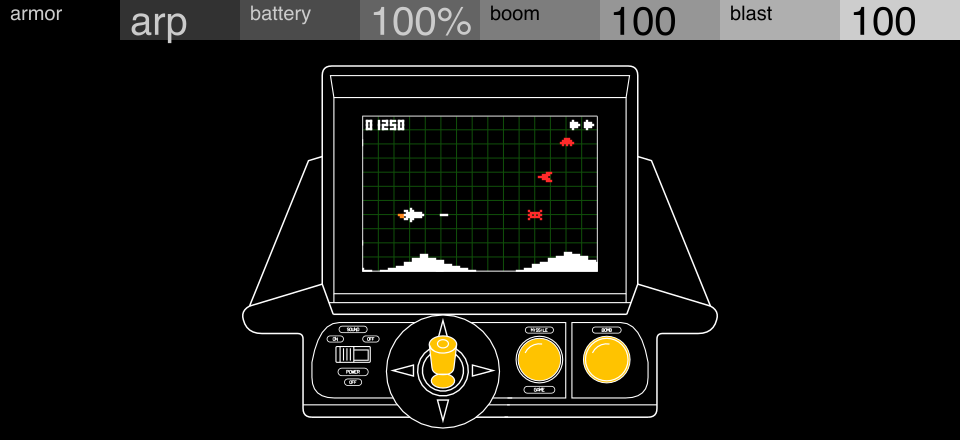

# Ofender

**[Pruébalo en el navegador](https://jjaimeros.github.io/op-xy-color-synths-things/ofender/docs/)**: con sonido y sin instalar nada.

Sinte de chiptune para el OP-XY, como motor de [Open-XY](https://github.com/etcetc000/open-xy) (ID `ofender`). La pantalla es una cabina arcade con un matamarcianos que juega solo.

| Pote | Nombre | Qué hace |
|---|---|---|
| 1 | Armor | Sonido de chip: `arp`, `arp2`, `arps`, `vibe`, `sine`, `zap`, `coin`, `noise` |
| 2 | Battery | Al 100 % no actúa. Al bajarla cae la frecuencia de muestreo de toda la voz (hasta unos 6,6 kHz) y el sonido de chip se desafina oscilando a 5 Hz, hasta ±1 semitono a 0 % |
| 3 | Boom | Volumen del bombo de cada nota (muestra `boom.wav`) |
| 4 | Blast | Volumen de la explosión de ruido de cada nota |

Cada nota pulsa un botón, alternando MISSILE y BOMB; con un acorde se hunden los dos. Cada enemigo abatido suma 10 puntos al marcador. El juego avanza con el transporte en marcha o con teclas pulsadas.

`tables.py` genera `tables.h` (con `boom.wav`); `artwork.py` (python3.12) genera `panel.svg.fragment` y `geometry.h` desde `cabina.svg`.

Firmware no oficial: úsalo bajo tu responsabilidad. Sin relación con Teenage Engineering.
