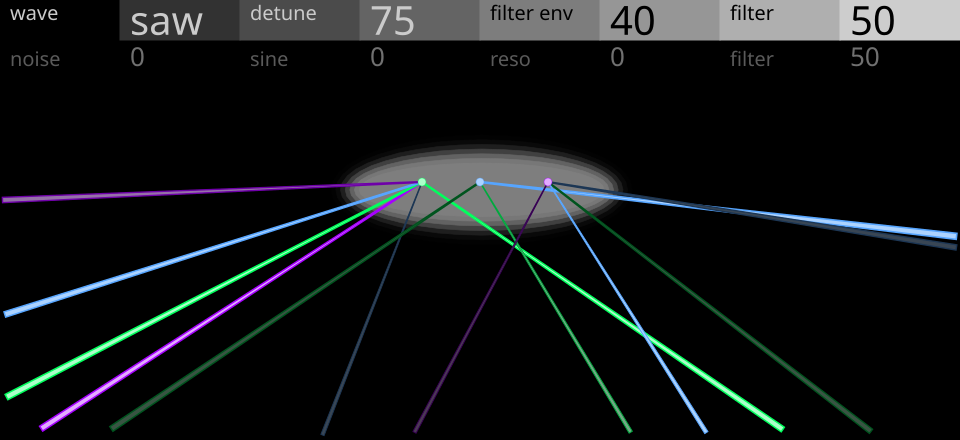

# Raver



**[Pruébalo en el navegador](https://jjaimeros.github.io/op-xy-color-synths-things/raver/docs/)**: con sonido y sin instalar nada.

Supersaw para sonidos de rave en el OP-XY, como motor de [Open-XY](https://github.com/etcetc000/open-xy) (ID `raver`).

| Página | Pote 1 | Pote 2 | Pote 3 | Pote 4 |
|---|---|---|---|---|
| 1 | Wave (saw, sqr, sub) | Detune | Filter Env | Filter |
| 2 | Noise | Sine | Reso | Filter |

Pulsar un encoder cambia de página. El pote 4 es el mismo en las dos.

- **saw y sqr:** 7 ondas con la curva y los desplazamientos de detune del supersaw, según el análisis publicado de Adam Szabo. Fases libres: cada nota empieza distinta.
- **sub:** un seno una octava abajo, un solo oscilador y sin detune.
- **Sine:** suma un seno una octava abajo a cualquiera de las ondas.
- **Filtro:** paso bajo de 2 polos con envolvente. En el centro, el pote de Filter Env vale 25.

En pantalla, un resplandor dispara láseres al azar, al tempo del proyecto y con fundido; Detune abre el abanico. En modo `sub` salen ondas hacia delante, una tanda cada 2 negras. La web no tiene transporte y va a 120 BPM.

El firmware instala un solo preset, `presets/default.json`.

## Desarrollo

Se compila con el [SDK de Open-XY](https://github.com/etcetc000/open-xy) v0.0.5, con el SDK en una carpeta al lado de este repositorio y con el [parche del SDK](../sdk-patch), incluido `tempo-en-pantalla.patch`: añade el tempo a la entrada de la pantalla, y sin él no compila.

```sh
python sdk.py test --machine ../op-xy-color-synths-things/raver --firmware
```

`artwork.py` genera `panel.svg.fragment` y `geometry.h`.

Firmware no oficial: úsalo bajo tu responsabilidad. Sin relación con Teenage Engineering ni con Roland.

## Licencia

El código es MIT, ver [LICENSE](LICENSE). La web de `docs/` usa la vista previa de Open-XY (MIT, ver `docs/LICENSE-Open-XY`).

Más sintes para el OP-XY en [op-xy-color-synths-things](..).
