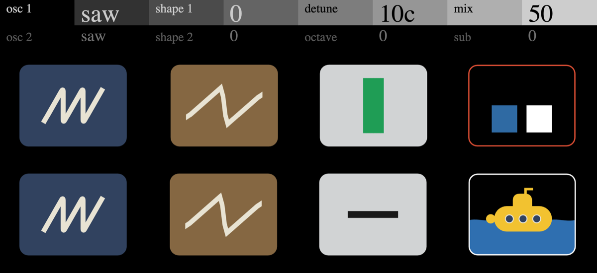

# Twin Osc



**[Pruébalo en el navegador](https://jjaimeros.github.io/op-xy-color-synths-things/twinosc/docs/)**: con sonido y sin instalar nada.

Sinte de dos osciladores para el OP-XY, como motor de [Open-XY](https://github.com/etcetc000/open-xy) (ID `twinosc`).

| Página | Pote 1 | Pote 2 | Pote 3 | Pote 4 |
|---|---|---|---|---|
| 1 | Wave 1 (saw/sqr/tri) | Shape 1 | Detune (0..50 cents) | Mix |
| 2 | Wave 2 | Shape 2 | Octave (osc 2, -2..+2) | Sub |

Pulsar un encoder cambia de página. La pantalla muestra las ondas, las flechas de octava, las barras de mezcla y un submarino que se hunde con Sub.

> Necesita el SDK con `draw::Input.playing`, un cambio propio que aún no está en Open-XY (ver el [parche del SDK](../sdk-patch)).

## Desarrollo

Se compila con el [SDK de Open-XY](https://github.com/etcetc000/open-xy), con el SDK en una carpeta al lado de este repositorio y con el [parche del SDK](../sdk-patch) aplicado:

```sh
python sdk.py test --machine ../op-xy-color-synths-things/twinosc --firmware
python sdk.py preview --source ../op-xy-color-synths-things/twinosc --out local/twinosc-prev --overwrite
```

No usa aritmética de 64 bits ni coma flotante en el motor (el compilador Blackfin para Mac no trae `libgcc`).

Firmware no oficial: úsalo bajo tu responsabilidad. Sin relación con Teenage Engineering.

## Licencia

MIT, ver [LICENSE](LICENSE). La web de `docs/` usa la vista previa de Open-XY (MIT, ver `docs/LICENSE-Open-XY`).

Más sintes para el OP-XY en [op-xy-color-synths-things](..).
